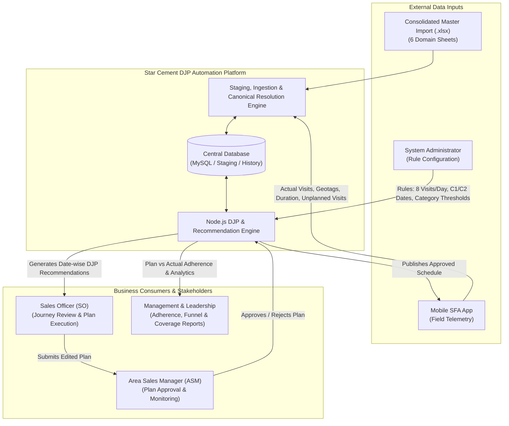
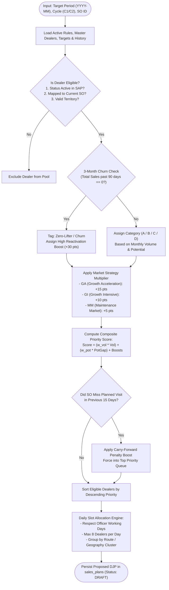
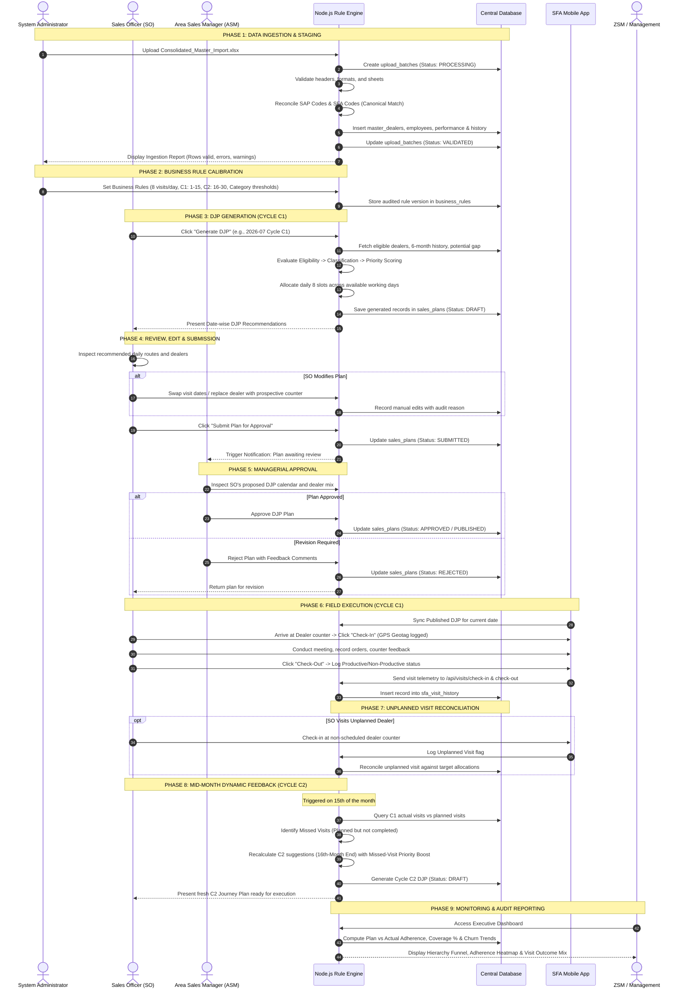
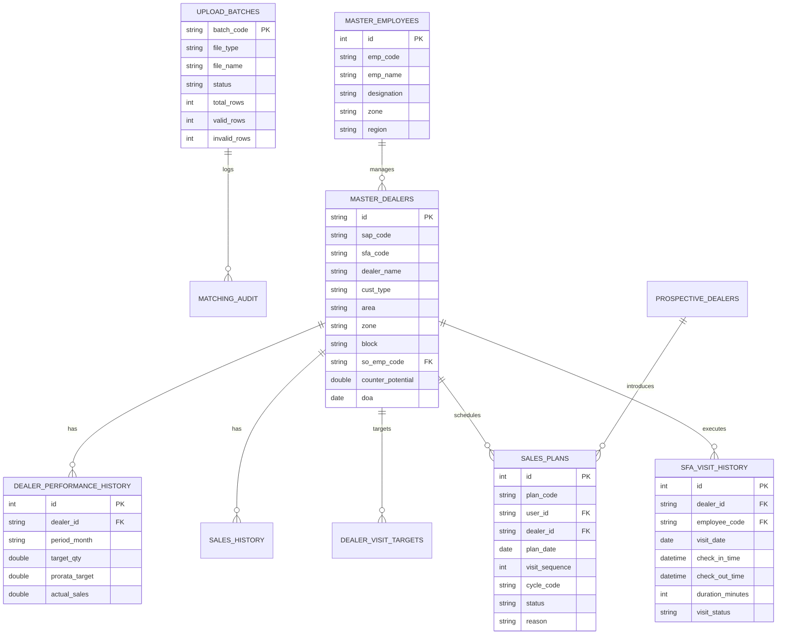

# STAR CEMENT PJP / DJP AUTOMATION
## Consolidated Master Import Specification, Data Flow Diagrams & End-to-End Journey

---

### Document Information
* **Document Title:** Star Cement PJP/DJP Automation System Architecture & End-to-End Operational Journey
* **Target Audience:** Engineering Team, Solution Architects, Business Analysts, Field Operations & System Administrators
* **Project Reference:** Node.js Rule Engine + Admin Panel + Unified Mobile API
* **Consolidated File:** `Consolidated_Master_Import.xlsx`
* **Version:** 1.0 (Production Architecture Spec)

---

## 1. Executive Summary

The **Star Cement PJP / DJP Automation Platform** replaces the manual, fragmented, Excel-based journey planning process with a centralized, configuration-driven recommendation engine and automated execution feedback loop. 

Historically, sales officers (SO) and managers spent dozens of hours monthly running manual Excel VLOOKUPs, applying disconnected formulas, and distributing static visit lists. This platform establishes:
1. **Single Unified Data Foundation:** Consolidates 6 disparate Excel sources (Dealer Mapping, Performance, Micro-market SBG, Historical Sales, Prospective Dealers, and SFA Execution) into a validated master repository.
2. **Deterministic Recommendation Engine:** Automatically categorizes dealers (A/B/C/D), identifies churn/zero-lifters, scores counter priorities, and creates optimized daily journey plans (8 visits/day/SO).
3. **Dual-Cycle Planning (C1 & C2):**
   * **Cycle C1 (1st–15th):** Initial baseline journey plan generated using historical performance and territory targets.
   * **Cycle C2 (16th–Month End):** Mid-month dynamic recalculation triggered on the 15th, factoring in actual execution, missed visits, and real-time demand conversion.
4. **Closed-Loop Field Feedback:** Seamlessly reconciles mobile check-in/out records, unplanned visits, and planned vs. actual adherence.

---

## 2. Consolidated Master Import Architecture

To streamline ingestion and eliminate manual errors across multiple independent file uploads, all required source data is consolidated into a single master workbook: [`Consolidated_Master_Import.xlsx`](file:///d:/OFFICE/DJP-project/DJP-project/Consolidated_Master_Import.xlsx).

### 2.1 File Location & Generated Assets
* **Root Location:** [`Consolidated_Master_Import.xlsx`](file:///d:/OFFICE/DJP-project/DJP-project/Consolidated_Master_Import.xlsx)
* **Template Directory:** [`templates/Consolidated_Master_Import.xlsx`](file:///d:/OFFICE/DJP-project/DJP-project/templates/Consolidated_Master_Import.xlsx)
* **Upload Archive Directory:** [`upload-files/Consolidated_Master_Import.xlsx`](file:///d:/OFFICE/DJP-project/DJP-project/upload-files/Consolidated_Master_Import.xlsx)
* **Workbook Compilation Script:** [`scripts/generate-consolidated-import.js`](file:///d:/OFFICE/DJP-project/DJP-project/scripts/generate-consolidated-import.js)
* **Automated Import Runner:** [`scripts/import-consolidated-runner.js`](file:///d:/OFFICE/DJP-project/DJP-project/scripts/import-consolidated-runner.js)

---

### 2.2 Sheet Breakdown & Data Dictionary

| Sheet Name | Source Module | Row Count | Target Database Tables | Key Fields & Identifiers |
| :--- | :--- | :--- | :--- | :--- |
| **`Index_and_Guide`** | System Guide | 18 rows | N/A (Metadata) | Ingestion order, versioning, data dictionary & constraints |
| **`Dealer_Mapping`** | Core Hierarchy | 109 rows | `master_dealers`<br>`master_employees`<br>`master_dealer_so_mapping` | `SAP Code`, `SFA Code`, `Dealer Name`, `Cust Type`, `Area`, `Zone`, `Block`, `SO Name`, `SO Emp Code`, `ASM Name/Code`, `RSM Name/Code`, `ZH Name/Code`, `DOA` |
| **`Dealer_Performance`** | Sales & Targets | 109 rows | `dealer_performance_history`<br>`master_dealers` | `SAP`, `CODE`, `DEALERS NAME`, `AREA`, `REGION`, `DOA`, `Targeted Dealer`, `EXCLUSIVE DEALER`, `June'26 Tgt`, `Prorata Tgt`, `Monthly Sales`, `6-Month Avg` |
| **`SBG_Master`** | Micro-Market | 109 rows | `master_dealers`<br>`territories` | `Customer Code`, `Dealer Name`, `Territory Code/Name`, `Block (Taluka)`, `Counter Potential Average (MT)`, `Zone`, `Status in SAP`, `Dealer Start Date` |
| **`Sales_History`** | RSAR / ERP | 462 rows | `sub_dealer_sales_history`<br>`sales_history` | `SAP Code`, `Sub Dealer Name`, `LinkedDealerCode`, `Linked Dealer Name`, `Zone`, `Jan-26` through `Jun-26` Monthly Volume |
| **`Prospect_Dealers`** | Growth Pipeline | 73 rows | `prospective_dealers` | `Zone`, `AREA`, `TALUKA`, `SFA CODE`, `PROSPECTIVE DEALER NAME`, `NAME OF SO`, `Potential (MT)`, `Expected Sale (MT)`, `Month` |
| **`SFA_Report`** | Execution Feedback | 109 rows | `sfa_visit_history`<br>`unplanned_visits` | `Date of Visit`, `Customer Code`, `Customer Name`, `Route`, `Branch`, `Employee Code/Name`, `Check In/Out Time`, `Duration`, `Visit Status`, `Purpose` |

---

### 2.3 Strict Pipeline Ingestion Order & Integrity Rules

```
Step 1: Dealer_Mapping
   │   (Establishes canonical dealers, employee hierarchy: SO -> ASM -> RSM -> ZH)
   ▼
Step 2: SBG_Master
   │   (Enriches dealers with territory codes, micro-market potential & SAP status)
   ▼
Step 3: Dealer_Performance
   │   (Attaches monthly targets, prorata targets, DOA tiers, and performance records)
   ▼
Step 4: Sales_History
   │   (Populates 6-month historical trend curves for churn and zero-lifter detection)
   ▼
Step 5: Prospect_Dealers
   │   (Injects vetted prospective dealers mapped to responsible Sales Officers)
   ▼
Step 6: SFA_Report
       (Logs field executions, duration, productive check-ins & triggers C2 feedback)
```

---

## 3. Data Flow Diagrams (DFD)

### 3.1 Level 0: System Context Diagram



---

### 3.2 Level 1: Functional Decomposition Data Flow Diagram

```mermaid
flowchart LR
    subgraph S1["1. File Ingestion & Staging"]
        F1["Consolidated Master File"] --> F2["upload_batches\n(Status: PROCESSING)"]
        F2 --> F3{"Schema Inspection\n& Type Validation"}
        F3 -- Valid Rows --> F4["Staging Data"]
        F3 -- Errors --> F5["matching_audit\n& Error Summary"]
    end

    subgraph S2["2. Canonical Matching & Persistence"]
        F4 --> M1["Canonical Matching Engine\n(SAP & SFA Code Reconciliation)"]
        M1 --> T1[("master_dealers")]
        M1 --> T2[("master_employees\n(SO, ASM, RSM, ZH)")]
        M1 --> T3[("dealer_performance_history")]
        M1 --> T4[("sales_history")]
        M1 --> T5[("prospective_dealers")]
        M1 --> T6[("sfa_visit_history")]
    end

    subgraph S3["3. Rule & Recommendation Engine"]
        T1 & T2 & T3 & T4 & T5 & T6 --> R1["Eligibility Filter\n(Active SAP, Mapped SO)"]
        R1 --> R2["Classification Engine\n(Core Dealer, Sub-Dealer, Prospect)"]
        R2 --> R3["Category Engine (A/B/C/D)\n& Market Strategy (GA/GI/MM)"]
        R3 --> R4["Priority Scoring Engine\n(Volume, Potential Gap, Churn Boost)"]
        R4 --> R5["Visit Frequency Matrix\n(Target Monthly Visits)"]
    end

    subgraph S4["4. Allocation & Schedule Generation"]
        R5 --> A1["Daily Allocation Engine\n(Strict Max 8 visits/day/SO)"]
        A1 --> A2["Dual-Cycle Partitioning\n(Cycle C1: 1-15 | Cycle C2: 16-End)"]
        A2 --> A3[("sales_plans\n& dealer_visit_targets")]
    end

    subgraph S5["5. Execution & Mid-Month Feedback"]
        A3 --> E1["SO Review & Edit"]
        E1 --> E2["ASM Approval"]
        E2 --> E3["Mobile Execution"]
        E3 --> E4["Mid-Month Dynamic Recalculation\n(Missed Visits Priority Boost)"]
        E4 -.->|Recalculate C2| A1
    end
```



---

### 3.3 Level 2: Rule Engine Internal Processing Flowchart



---

## 4. End-to-End Journey Representation

The end-to-end journey encompasses **9 distinct operational phases** across 4 key roles: **Admin**, **Sales Officer (SO)**, **Area Sales Manager (ASM)**, and **Zonal Leadership (ZSM)**.



---

## 5. Detailed Phase Descriptions

### Phase 1: Consolidated Data Ingestion & Validation
* **Trigger:** Monthly file upload or ad-hoc data refresh by the administrator.
* **Mechanism:** Single upload of [`Consolidated_Master_Import.xlsx`](file:///d:/OFFICE/DJP-project/DJP-project/Consolidated_Master_Import.xlsx).
* **Validation Pipeline:**
  1. Header normalization (case-insensitive, trims underscores, hyphens, and whitespace).
  2. Data type and date parsing (supports ISO dates, Excel serial numbers, `Jun-26`, `June'26`).
  3. Canonical matching: Reconciles SAP Codes with SFA Codes into a persistent `dealer_id`.
  4. Logging in `upload_batches` with row counts (`valid_rows`, `invalid_rows`, `duplicate_rows`).

### Phase 2: Hierarchy & Master Resolution
* **Mapping Hierarchy:** `Sales Officer (SO)` $\rightarrow$ `Area Sales Manager (ASM)` $\rightarrow$ `Regional Sales Manager (RSM)` $\rightarrow$ `Zonal Head (ZH)`.
* **Conflict Prevention:** Employee designations are preserved upon initial creation to prevent designation flip-flops across different file lines.
* **Master Dealers:** Unique dealer record keyed by canonical ID, containing current SO assignment, territory, counter potential, and activation date (DOA).

### Phase 3: Rule Configuration & Parameter Management
* **Configurable Parameters:**
  * **Daily Dealer Capacity:** Default is 8 visits/day/SO (configurable without code modifications).
  * **Cycle Boundaries:** C1 (1st–15th), C2 (16th–Month End).
  * **Category Thresholds:** Metric volume thresholds for Class A, B, C, D counters.
  * **Scoring Weights:** Tunable weights for volume, potential gap, churn reactivation, and exclusive status.

### Phase 4: Automated DJP Generation Engine
* **Execution Flow:**
  1. `Eligibility Filter`: Removes inactive SAP counters or unassigned dealers.
  2. `Churn Engine`: Evaluates 3-month trailing sales; dealers with 0 sales are flagged as zero-lifters.
  3. `Potential Gap`: Calculated as $\text{Potential Gap} = \max(0, \text{Counter Potential} - \text{Current Sales})$.
  4. `Priority Engine`: Calculates weighted composite score.
  5. `Daily Allocation`: Sequentially fills up to 8 slots per planning day.

### Phase 5: Field Officer (SO) Plan Review & Editing
* **Empowerment with Guardrails:** SOs can view system recommendations and make necessary field adjustments:
  * Reorder sequence of visits on any given date.
  * Swap dealer visits across dates.
  * Substitute an existing dealer with an approved prospective dealer.
  * *Auditability:* Every manual edit requires an operational reason code and remains distinguishable from system-generated suggestions.

### Phase 6: Managerial Approval Workflow
* **Approval Chain:** SO submits plan $\rightarrow$ ASM reviews proposed schedule.
* **Review Criteria:** ASM inspects coverage balance, high-potential dealer inclusion, and geographical logic.
* **Actions:** Approve (locks plan as `PUBLISHED`), Reject (returns plan to SO with review comments).

### Phase 7: Mobile App Field Execution & Geotagging
* **Daily Operations:** The field officer accesses the published daily plan on the mobile app.
* **Verification:** Geotagged GPS coordinates and timestamp logged on "Check-In" and "Check-Out".
* **Outcome Recording:** Productive (with sales conversion/order booking) vs Non-Productive (with reason codes: shop closed, owner unavailable, etc.).

### Phase 8: Mid-Month C2 Dynamic Feedback Loop
* **Dynamic Recalculation Date:** 15th of each month.
* **Feedback Ingestion:** Reads completed visits vs planned visits from C1.
* **Carry-Forward Rule:** Unvisited/missed dealers receive a priority boost in Cycle C2 so they are scheduled without exceeding daily capacity limits.

### Phase 9: Executive Monitoring & Adherence Analytics
* **Visibility:**
  * **Plan vs Actual Adherence:** Tracks execution percentage against initial commitments.
  * **Coverage Analysis:** Identifies counters with zero visits over 30/60/90 days.
  * **Hierarchy Performance:** Roll-up adherence from SO to ASM, RSM, and Zone.

---

## 6. Database Schema Reference



---

## 7. How to Run & Automate

### 7.1 Recompiling the Consolidated Master Import File
If source files in `upload-files/` are modified, regenerate the master workbook at any time:
```powershell
node scripts/generate-consolidated-import.js
```

### 7.2 Executing the Automated Ingestion Pipeline
To ingest the consolidated file into the database across all 6 domains in the correct dependency sequence:
```powershell
node scripts/import-consolidated-runner.js
```

### 7.3 Direct API Upload Endpoint
Administrators can also upload the file directly via the web portal or API:
* **Endpoint:** `POST /api/upload`
* **Form-Data:**
  * `file`: `Consolidated_Master_Import.xlsx`
  * `uploadType`: `DEALER_MAPPING` (or individual domain selectors)
